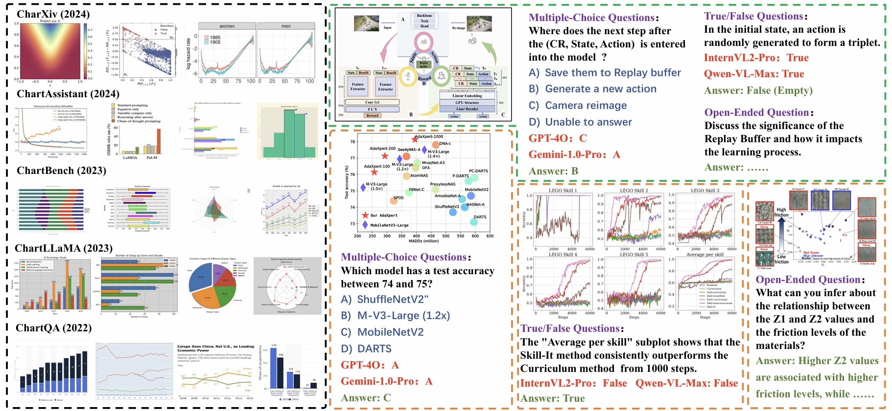
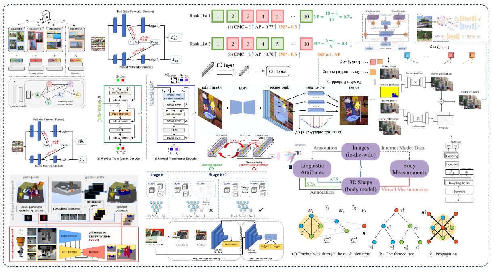
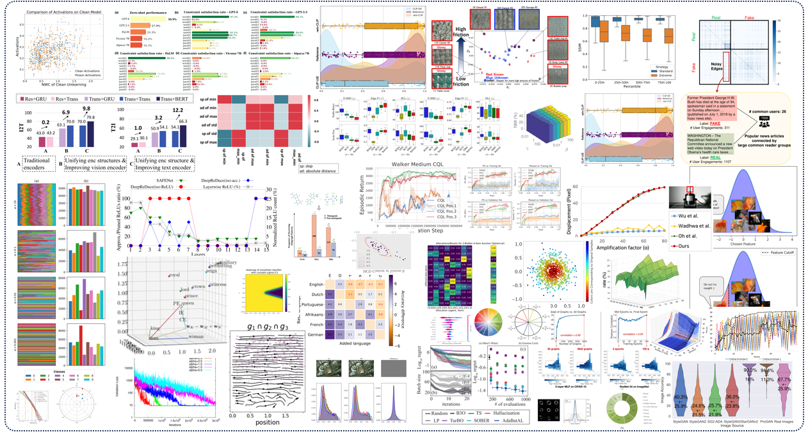
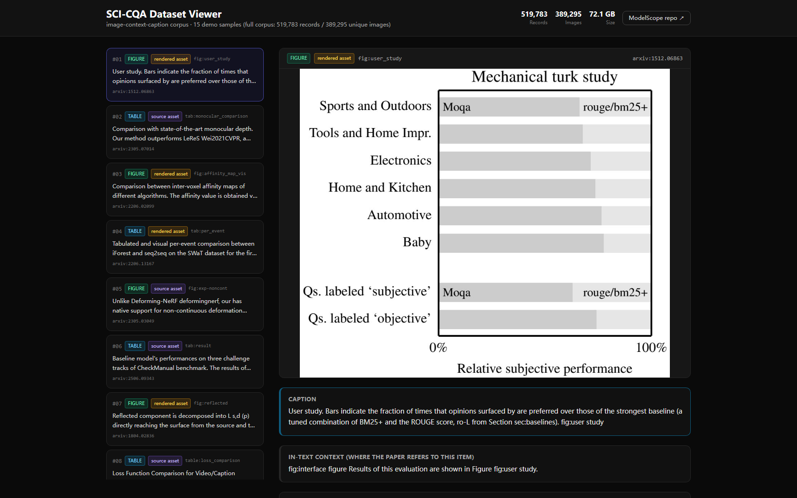

<!-- The official repository of the paper 'Advancing Scientific Chart Understanding: The SCI-CQA Benchmark and Beyond' (IEEE TIP 2026) -->

#  Advancing Scientific Chart Understanding: The SCI-CQA Benchmark and Beyond

<h5 align="center"> If you like our project, please give us a star ⭐ on GitHub for latest update. 

## 📰 News
- 26-10-20. 🎉 The paper is published in **IEEE Transactions on Image Processing**, Vol. 35, pp. 10829–10841 ([IEEE Xplore](https://ieeexplore.ieee.org/document/11715981), DOI: 10.1109/TIP.2026.3725719).
- 26-10-20. We release the **519K-record image-context-caption corpus** on [ModelScope](https://modelscope.cn/datasets/lyndons/SCI-CQA-Datasets), along with a self-contained offline demo viewer (see below).
- 24-09-05. We release the test set of SCI-CQA, which can be downloaded at HF.


# ⭐️ Motivation

<p align="center">
    
<p>
SCI-CQA address the limitations of current benchmarks and provide a more robust framework for evaluating the chart understanding abilities of multimodal models in scientific literature contexts.

- ✨ SCI-CQA highlights **flowcharts**, a crucial yet often overlooked chart type in scientific literature.
- ✨ By using **real-world scientific charts** with intricate visual elements, addressing the shortcomings of existing benchmarks that rely on overly simplistic visual elements.
- ✨ SCI-CQA introduces an evaluation framework inspired by human exams, featuring **5,629** carefully curated questions that include both **objective and open-ended formats**.

# 📈 Dataset 
### The following figure consists of a randomly selected set of flowcharts. 
From this picture, it can be seen that the flowchart in the scientific literature proposed by SCI-CQA has complex visual patterns and rich visual features.
<p align="center">
    
<p>
    
### The following figure consists of a randomly selected set of data charts. 
This figure shows the data complexity and visual richness of SCI-CQA. The charts produced by humans are often beautiful and with complex data distribute, which is very different from the synthesized data.    
<p align="center">
    
<p>

The SCI-CQA test set is available at 🔗[Hugging Face](https://huggingface.co/datasets/lyndons1/SCI-CQA), and the large-scale image-context-caption corpus is available at 🔗[ModelScope](https://modelscope.cn/datasets/lyndons/SCI-CQA-Datasets).

# 📦 Image-Context-Caption Corpus

Alongside the benchmark we release the underlying mined corpus: **519,783 (image, caption, in-text context) triples** (~72 GB) covering figures and tables from scientific papers. Each record links a figure/table to its original caption **and** the paragraph in which the paper refers to it — suitable for chart understanding, figure grounding, and context-aware captioning.

| Item | Value |
|---|---|
| Records (`pairs.jsonl.gz`) | 519,783 |
| Unique media (incl. all listed alternatives) | 389,295 |
| Item kinds | `figure`, `table` |
| Total size | ~72 GB (11 archives) |
| Download | [ModelScope — lyndons/SCI-CQA-Datasets](https://modelscope.cn/datasets/lyndons/SCI-CQA-Datasets) |

### Offline demo viewer

The [`viewer/`](viewer) folder contains a self-contained offline viewer for a 15-record demo subset. It needs **no installation and no web server**: download the folder and double-click `viewer/index.html` — it opens directly in any modern browser. Each record shows the image, its original caption, the in-text reference context, and provenance metadata.

<p align="center">
    
<p>

# ⚙️ Evaluation
### Testing the open source model（Use LLaVA as an example）

**chartllama_experiment.py** and **llava_experiment.py** in the LLaVA folder give sample scripts for testing the open source model, which you can follow to adapt to your model.

> **Note (Oct 2026):** the dependency pins in `LLaVA/pyproject.toml` were raised for security fixes (torch 2.6.0 / transformers 4.53.0 / gradio 4.44.0, etc.). The original experiments were run with torch 2.1.2 / transformers 4.37.2; if you need bit-exact reproduction, use those earlier versions in an isolated environment.

    CUDA_VISIBLE_DEVICES=1 python -m llava.eval.model_vqa_lora --model-path /home/data_sld/chartllama_lora \
      --question-file ./data/multi-choice.json \
      --image-folder ./images/charts/ \
      --answers-file answer.jsonl \
      --num-chunks $CHUNKS \
      --chunk-idx $IDX \
      --temperature 0 \
      --conv-mode vicuna_v1 &
      
### Testing the private model model（Use GPT-4o as an example）

To use the following script, you need an **API-KEY** to make private model works.

    python tools/gpt4_api_evl.py 

# 🛠️ Tools
Our data collection code is also published, if you plan to collect data in another area (maybe biomedicine
chemistry and so on), you can try our methods.

### Download Latex source file

    python /tools/down_papers.py
    
### Collect scientific literature

    python /tools/fetch_papers.py

### Get Arxiv URL of scientific literature

    python /tools/get_arxiv_links.py

### Extract images and their corresponding context and captions from LaTeX source files.

    python /tools/process_papers.py

# 🙏 Acknowledgement

We thank the following excellent works: [CharXiv](https://github.com/princeton-nlp/CharXiv), [ChartQA](https://arxiv.org/abs/2203.10244), and [ChartAst](https://github.com/OpenGVLab/ChartAst), [LLaVA](https://llava-vl.github.io/).

SCI-CQA is inspired by previous excellent works, and we are standing on the shoulders of giants for further exploration.


# 📒 License & Disclaimer
* The majority of this project is released under the Apache 2.0 license as found in the [LICENSE](LICENSE) file.
* This project (code and data) is intended for **non-commercial academic research only**.
* All charts, captions, and text snippets are collected from illustrations in the scientific literature; **all copyrights remain with the original authors and publishers**.
* If you are a rights holder and believe any content should not be included, please contact us (e.g., via GitHub Issues) and we will remove the material promptly.


# 🫡 Citation
If you find our paper and code useful in your research, please consider giving a star or citation.

```BibTeX
@article{shen2026scicqa,
  author  = {Shen, Lingdong and Qigqi and Ding, Kun and Xu, Jian and Meng, Gaofeng and Xiang, Shiming},
  title   = {Advancing Scientific Chart Understanding: The SCI-CQA Benchmark and Beyond},
  journal = {IEEE Transactions on Image Processing},
  volume  = {35},
  pages   = {10829--10841},
  year    = {2026},
  doi     = {10.1109/TIP.2026.3725719}
}
```

Paper: [IEEE Xplore](https://ieeexplore.ieee.org/document/11715981)
